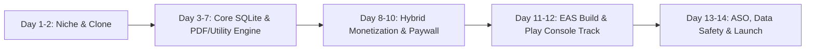

# 🏭 Mobile App Factory — 14-Day Commercial Pipeline Blueprint

> **Base Golden Chassis:** `D:\MobileFactory\mobile-factory-template`
> **First Flagship Production App:** `D:\MobileFactory\veloquote-app` (`com.mobilefactory.veloquote`)
> **Core Stack:** Expo SDK 55 + React Native 0.83 + NativeWind v4 + Expo SQLite (Offline-First) + Google AdMob + RevenueCat Paywall + EAS Build

---

## PART 1: THE 14-DAY SPRINT SCHEDULE (2-WEEK APP FACTORY CYCLE)

Every 14 days, the Mobile Factory clones `mobile-factory-template` and ships a high-intent micro-SaaS utility app to the Google Play Store using this exact repeatable execution cadence:



### 📅 Days 1–2: Niche Selection, Keyword Validation & Template Clone
- **Market Validation:** Pick a high-intent B2B, contractor, freelancer, or daily-utility niche where users actively search for a tool to save time or make money (e.g., quotes, receipts, inventory, work hours, field inspections).
- **Clone the Golden Chassis:**
  ```powershell
  $env:TEMP="D:\temp"; $env:TMP="D:\temp"
  Copy-Item -Path "D:\MobileFactory\mobile-factory-template" -Destination "D:\MobileFactory\<new-app-slug>" -Recurse
  ```
- **Identity Setup (`app.json`):**
  - Set `name`, `slug`, `scheme`, `ios.bundleIdentifier`, and `android.package` (`com.mobilefactory.<appname>`).
  - Verify `android.versionCode: 1` and `permissions: ["com.android.vending.BILLING", "android.permission.INTERNET"]`.

### 📅 Days 3–7: Core Engine & Offline-First SQLite Architecture
- **Database Schema (`src/services/database.ts`):**
  - Design 1–2 primary SQLite tables + a settings/profile table with automatic migration and realistic seed data so first-time users immediately see a rich dashboard.
- **High-Value Output Generator (`src/services/pdf-generator.ts` or Export Engine):**
  - Build the tangible output that users share with their clients/bosses (e.g., HTML-to-PDF documents via `expo-print` + `expo-sharing`, CSV reports, or visual summary cards).
- **Executive Dark UI (`src/app/index.tsx`):**
  - KPI Summary Cards at the top, Filter Pills in the middle, Actionable Item Cards with one-tap status cycling, and clean creation/settings modals.

### 📅 Days 8–10: Hybrid Monetization, Free-Limit Hook & Paywall Wiring
- **The 3-Layer Monetization Funnel:**
  1. **Free Tier Hook:** Give the user **3 full-featured records/exports for free** so they experience the "Aha!" moment immediately.
  2. **Rewarded Video Bridge (`src/services/admob.ts`):** When the free limit is reached, offer a dual-choice modal: *"Watch a short video for +1 Credit"* OR *"Upgrade to Pro for Unlimited"*.
  3. **3-Tier RevenueCat Paywall (`src/components/paywall-modal.tsx`):**
     - **Weekly Pro ($1.99/wk):** Low-friction entry for urgent one-week projects.
     - **Annual Pro ($14.99/yr — Highlighted "85% SAVE"):** Highest LTV anchor plan.
     - **Lifetime Pro ($24.99 one-time):** High-converting option for subscription-averse tradespeople.
- **Compliance Verification:** Ensure `LegalModal` (`src/components/legal-modal.tsx`) is wired to the Paywall footer and Settings screen so reviewers can read Privacy Policy & Terms both in-app and via browser.

### 📅 Days 11–12: EAS Cloud Build & Play Console Closed/Production Track
- **Step 1 — Direct Phone APK Test (`preview` profile):**
  ```powershell
  $env:TEMP="D:\temp"; $env:TMP="D:\temp"
  cd D:\MobileFactory\<app-slug>
  npx tsc --noEmit
  eas build --platform android --profile preview
  ```
  Download the generated `.apk` onto a physical Android device and test SQLite persistence, PDF export, AdMob banners, and Paywall restore flow.
- **Step 2 — Play Store Signed App Bundle (`production` profile):**
  ```powershell
  eas build --platform android --profile production
  ```
  Upload the signed `.aab` file to **Google Play Console > Internal / Closed Testing** or **Production**.

### 📅 Days 13–14: ASO Store Listing, Data Safety & Release
- **Store Listing & Localization:** Copy the bilingual (`tr-TR` and `en-US`) titles, 80-char short descriptions, and 4000-char keyword-rich descriptions from `store-listing/PLAY_STORE_LISTING_TR_EN.md`.
- **Host Privacy Policy:** Deploy `store-listing/PRIVACY_POLICY.html` to GitHub Pages / Cloudflare Pages and link the URL in Play Console > App Content > Privacy Policy.
- **Complete Data Safety & In-App Products:** Create the 3 SKUs (`<app>_weekly`, `<app>_annual`, `<app>_lifetime`), link them in RevenueCat, submit for review, and begin Day 1 of the next app!

---

## PART 2: 5 HIGH-CONVERTING COMMERCIAL APP IDEAS (NEXT IN PIPELINE)

All 5 apps below are engineered to be cloned directly from `D:\MobileFactory\mobile-factory-template` with **zero backend cost** (100% local SQLite + PDF/Print engine + AdMob + RevenueCat):

---

### 🚀 App #2: **SnapReceipt: Kira & Tahsilat Makbuzu PDF** (`com.mobilefactory.snapreceipt`)
* **Target Audience:** Landlords, property managers, building superintendents (apartman/site yöneticileri), field collection agents, tutors, and small service vendors who receive cash/IBAN payments and need to issue an instant signed digital receipt.
* **Core Engine (SQLite + PDF):**
  - Record payer name, amount, currency, payment method (Cash, EFT/IBAN, Check), payment category (Rent, Deposit, Dues/Aidat, Service Fee), and digital signature/stamp box.
  - Generates a sleek, numbered **Official Payment Receipt PDF (Tahsilat / Kira Makbuzu)** ready to send on WhatsApp in 15 seconds.
* **Free-Limit Hook:** First **3 Receipts** are completely free.
* **Rewarded Ad Trigger:** *"Watch a short video to issue +1 Receipt PDF with digital stamp"* or *"Remove watermark on this receipt"*.
* **Pro Subscription Value ($1.99/wk | $14.99/yr | $24.99 Lifetime):** Unlimited receipts, custom company logo/stamp on PDFs, tenant/client payment history ledger, and 100% ad-free speed.

---

### 🚀 App #3: **ShiftLedger: Puantaj, Mesai & Yevmiye Takip** (`com.mobilefactory.shiftledger`)
* **Target Audience:** Construction foremen (şantiye şefleri / kalfalar), workshop owners, daily wage workers (yevmiyeli çalışanlar), security/cleaning shift supervisors, and freelancers tracking billable hours.
* **Core Engine (SQLite + PDF):**
  - Daily attendance & overtime grid: mark workers as *Full Day (Tam Gün)*, *Half Day (Yarım Gün)*, *Overtime Hours (Fazla Mesai)*, and *Cash Advance Deducted (Avans Kesintisi)*.
  - One-tap **Monthly Payroll & Timesheet PDF Report (Aylık Puantaj ve Hak Ediş Cetveli)** to share with workers or accounting.
* **Free-Limit Hook:** Track up to **3 Workers / Projects** and export **2 Timesheet PDFs** for free.
* **Rewarded Ad Trigger:** *"Watch a rewarded video to unlock +1 Worker slot or export this week's Payroll PDF"*.
* **Pro Subscription Value:** Unlimited workers & sites, automatic overtime multiplier calculator (1.5x / 2.0x), advance/debt balance tracking, and white-label PDF payroll exports.

---

### 🚀 App #4: **SitePunch: Şantiye Eksik Listesi & Fotoğraflı Saha Raporu** (`com.mobilefactory.sitepunch`)
* **Target Audience:** Architects, civil engineers, interior designers, real estate inspectors, renovation contractors, and facility managers conducting site walkthroughs (Punch List / Snag List).
* **Core Engine (SQLite + PDF):**
  - Log defects/tasks by room or zone with priority (*Critical, Medium, Cosmetic*), assigned subcontractor, due date, and status (*Open, In Progress, Resolved*).
  - Generates a structured **Site Inspection & Punch List PDF Report** to hand over to subcontractors on WhatsApp.
* **Free-Limit Hook:** **1 Active Inspection Project** (up to 10 punch items) and **2 PDF Reports** free.
* **Rewarded Ad Trigger:** *"Watch a short ad to export an updated Punch List PDF or add +5 extra defect items"*.
* **Pro Subscription Value:** Unlimited inspection projects, unlimited items, custom company header on PDF reports, and zero ads during client walkthroughs.

---

### 🚀 App #5: **StockPulse: Barkodsuz Hızlı Stok, Depo & Maliyet Sayım** (`com.mobilefactory.stockpulse`)
* **Target Audience:** Small retail shopkeepers, hardware stores (nalbur/elektrikçi), auto-parts sellers, market stalls, e-commerce sellers, and van-sales drivers who need fast offline inventory and profit margin tracking without complex ERP systems.
* **Core Engine (SQLite + PDF):**
  - Track item SKU/name, category, buy cost, sell price, current stock quantity, and low-stock alert threshold.
  - Instant calculation of **Total Inventory Value (Toplam Depo Maliyeti)** and **Expected Gross Profit**, plus one-tap **Stock Count & Price List PDF Export**.
* **Free-Limit Hook:** Up to **15 Inventory Items** free.
* **Rewarded Ad Trigger:** *"Watch a short video to add +5 Inventory Item slots or export a Customer Price List PDF"*.
* **Pro Subscription Value:** Unlimited inventory items, low-stock warning filter, one-tap wholesale Price List PDF generator for customers, and 100% ad-free operation.

---

### 🚀 App #6: **FleetLog: Araç Bakım, Yakıt & Sefer Masraf Defteri** (`com.mobilefactory.fleetlog`)
* **Target Audience:** Courier drivers, taxi/transfer drivers, commercial van owners, trucking owner-operators (kamyon/nakliye esnafı), and field sales reps tracking vehicle expenses and per-kilometer profitability.
* **Core Engine (SQLite + PDF):**
  - Log trip revenue (Navlun/Sefer Geliri) vs. expenses (Fuel/Mazot, Toll/HGS, Maintenance/Bakım, Tire/Sanayi) and odometer readings.
  - Calculates **Net Trip Profit** and generates a **Monthly Vehicle Expense & Reimbursement PDF Report** for tax or employer submission.
* **Free-Limit Hook:** **5 Trip / Expense Logs** and **2 PDF Reimbursement Reports** free.
* **Rewarded Ad Trigger:** *"Watch a rewarded video to export your Monthly Expense PDF or log +3 extra trips"*.
* **Pro Subscription Value:** Unlimited vehicles & trip logs, maintenance countdown reminders (oil change / inspection km alerts), unlimited PDF expense reports, and ad-free dashboard.

---

## PART 3: STANDARDIZED MONETIZATION MATRIX ACROSS ALL FACTORY APPS

| Metric / Component | Standard Factory Configuration |
| :--- | :--- |
| **Free Tier Hook** | 3 Free High-Value Outputs (PDFs / Projects) — enough to prove utility immediately |
| **Rewarded Ad Placement** | Triggered at Free Limit wall (`+1 Output Credit`) — monetizes non-paying users at $15–$40 eCPM |
| **Interstitial Ad Placement** | Shown after successful PDF export / status milestone (capped to protect UX & store rating) |
| **Banner Ad Placement** | Pinned neatly above bottom safe area (`AdBannerSlot`), hidden automatically for Pro users |
| **Weekly Subscription** | `$1.99 / week` (`<app>_weekly`) — captures short-term urgent business users |
| **Annual Subscription** | `$14.99 / year` (`<app>_annual`) — pre-selected default plan with `EN POPÜLER • %85 TASARRUF` badge |
| **Lifetime License** | `$24.99 one-time` (`<app>_lifetime`) — captures anti-subscription contractors & tradespeople |
