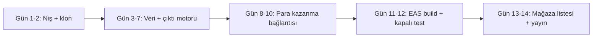

# 14 Günlük Üretim Hattı

> Kurallar için: [FACTORY_RULES.md](FACTORY_RULES.md). Bu belge "ne zaman, hangi sırayla" sorusunu yanıtlar.



## Gün 1–2 · Niş seçimi ve klon
- İnsanların aktif olarak aradığı, para kazandıran veya zaman kazandıran bir B2B/esnaf nişi seç.
- Anahtar kelimeyi Play aramasında doğrula (rakip sayısı, puanları, son güncelleme tarihi).
- Şablonu klonla, `factory.config.js` içinde ad / paket / slug / e-posta / önek belirle, `eas init`.

## Gün 3–7 · Veri ve çıktı motoru
- `src/services/database.ts` → `MIGRATIONS` listesine uygulamanın tablolarını ekle (boş başlar).
- Depo (repository) servisi: `src/services/<alan>.ts` (bkz. `records.ts` kalıbı).
- Çıktı: `src/services/pdf.ts` ile A4 HTML şablonu; kullanıcı girdisi her zaman `escapeHtml`.
- Ana ekran: KPI kartları → filtreler → kayıt kartları → boş durum + tek net CTA.
- Tüm metinler `src/i18n/en.ts` + `tr.ts`.

## Gün 8–10 · Para kazanma
- Play Console: `<önek>_weekly|monthly|annual` abonelikleri + `<önek>_lifetime` tek seferlik ürün.
- RevenueCat: uygulama, ürünler → `pro_access` entitlement → "current" offering. Public anahtar → config.
- AdMob: uygulama + banner / interstitial / rewarded birimleri → config. UMP GDPR mesajını yayınla.
- Kota kapısı: çıktıdan önce `canUseUnit()`, başarılı çıktıdan sonra `consumeUnit()`.
- Paywall faydaları uygulamaya özel yazılır (`<PaywallModal benefits={[...]} />`).

## Gün 11–12 · Derleme ve kapalı test
```bash
npm run typecheck && npx expo export --platform android
npx eas-cli@latest build --platform android --profile preview      # telefona APK
npm run verify:release
npx eas-cli@latest build --platform android --profile production   # .aab
```
- Fiziksel cihazda test: ilk açılış, TR/EN, koyu/aydınlık, satın alma + iptal, geri yükleme, ödüllü reklam,
  uçak modu, PDF paylaşımı.
- Play Console → Kapalı test: en az 12 gerçek testçi, 14 gün.

## Gün 13–14 · Mağaza ve yayın
- Listeleme: başlık ≤ 30, kısa açıklama ≤ 80, yalnızca gerçek özellikler. Kategori + 5 etiket.
- Grafikler: 512 ikon (tam kare), 1024×500 feature graphic, gerçek ekranlardan 4+ ekran görüntüsü.
- Veri güvenliği formu: AdMob (reklam kimliği, cihaz, yaklaşık konum), RevenueCat (satın alma geçmişi, kullanıcı kimliği).
- Gizlilik politikası URL'si → Play Console + `factory.config.js`.

---

## Sıradaki uygulama fikirleri

| Kod adı | Niş | Çıktı | Not |
|---|---|---|---|
| **SitePunch** | Şantiye eksik listesi, saha denetimi | Fotoğraflı denetim / punch list PDF | Kamera + görüntü sıkıştırma gerekir |
| **StockPulse** | Küçük esnaf stok & maliyet | Stok sayım ve fiyat listesi PDF | Barkod tarama Pro özelliği olabilir |
| **FleetLog** | Kurye/nakliye araç masrafı | Aylık masraf ve kilometre raporu PDF | Kilometre bazlı kârlılık |
| ~~ShiftLedger~~ | Puantaj | — | VeloHours'a "çoklu çalışan" modu olarak eklenmeli |

Her fikir için ilk iş: Play'de anahtar kelime araması + en iyi 5 rakibin yorumlarındaki şikâyetleri listelemek.
